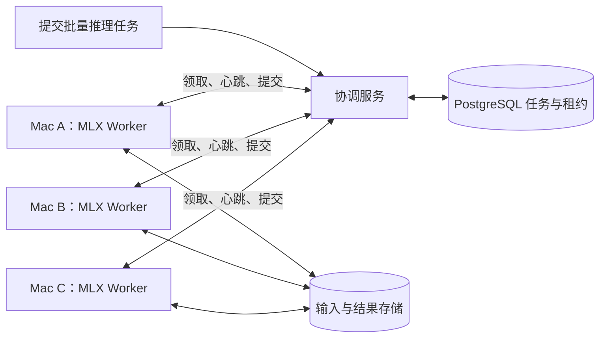

论文：https://arxiv.org/html/2610.12970v1#S2
普通电脑上运行llm:https://github.com/Niko1221/Strata,增加MAC设备支持：https://github.com/Niko1221/Strata/releases/tag/v0.1.44
Mac 设备加速优化：https://github.com/hokar3361/moe-on-a-desk

**可以实现，而且 MLX 很适合承担其中的本地推理部分。**我已通读这篇论文的正文。我的判断是：最值得先做的是“多台闲置 Mac 协作处理批量 LLM 任务”，核心工作在任务调度、故障恢复和资源管理，通常不需要自己重写模型计算算法。

需要先区分两个目标：

| 目标 | 可行性与路线 |
|---|---|
| 多台 Mac 分别处理不同请求，提高总体吞吐量 | 适合复现论文方案，用 MLX 做每台机器的推理引擎 |
| 一个模型放不进单台 Mac，希望拆到多台机器运行 | MLX 有相关能力，但属于另一条技术路线，对互联和节点稳定性要求更高 |

论文中的“虚拟 GPU 云”不能理解成透明合并多台 Mac 的显存。

**论文实际做了什么**

这篇《Minions》由 Apple 作者署名，主要是系统实践：Server 拆分任务，Mac Executor 主动领取子任务，本地推理后把结果写入对象存储；PostgreSQL 唯一约束用于竞争领取，Watchdog 回收失联任务，任务绑定用于偏好选择。LLM 后端使用 Ollama，embedding 使用 Hugging Face Transformers。

它没有提出新的模型并行算法，也没有给出详尽的吞吐、能耗或扩展效率基准。其报告的主要收益是减少等待可用 GPU 的时间。因此，不能据此推断 MLX 版本能获得多少推理加速。[论文全文](https://arxiv.org/html/2610.12970v1)

**映射到 MLX，需要实现哪些部分**

MLX LM 已提供模型加载、量化、文本生成、流式生成和批量生成入口，可以直接作为 Worker 的计算后端。[MLX LM 官方仓库](https://github.com/ml-explore/mlx-lm)

我建议采用下面的结构，这是面向我们实现的设计：



这里每台 Mac 保存完整模型，机器之间不交换每层的激活值或 KV cache。首版可以不使用 `mx.distributed`。

建议重点实现以下五项算法或机制，**它们是我们的实现建议，不是论文已经完整给出的方案**。

**1. 按预计计算量拆分任务**

不能简单地把每 100 条请求分成一组：短问答和长文摘要的计算量可能差很多。

可以先估计：

\[
\widehat T =
\frac{N_{\text{input}}}{r_{\text{prefill}}}
+
\frac{\widehat N_{\text{output}}}{r_{\text{decode}}}
\]

其中两种速率按“设备、模型、运行配置”分别测量，输出长度使用上限或历史估计。

用它把任务切成耗时相近的小批次，避免某台慢机器拖住最后一大块工作。该公式只是初始估算，批处理后的实际速率需要在线校正。

**2. 带租约和版本号的任务领取**

这是可靠性上最重要的部分。

例如：

```text
queued → running → succeeded
             ↓
       租约超时 → queued
```

每次领取产生新的 `attempt_id` 或递增的 fencing token，提交结果时必须核对当前持有者和版本。

原因是：Mac A 断网后，任务可能已经转交 Mac B；A 恢复网络时仍可能提交旧结果。**数据库里只有一个当前持有者，并不意味着只有一台机器还在计算。**

因此应采用：

- 允许失败任务重试；
- 只接受当前有效尝试的结果；
- 每条输入有稳定 ID，汇总时去重；
- 每次尝试写入独立结果路径，避免旧 Worker 覆盖文件。

目标是“允许重复执行，但有效结果只提交一次”。

**3. 兼顾设备能力和模型缓存的任务选择**

先过滤不符合条件的任务，再排序：

```text
权限允许
→ 模型与运行版本兼容
→ 内存预算足够
→ 项目偏好
→ 模型已缓存或已加载
→ 等待时间
```

内存预算要覆盖：

\[
M_{\text{weights}}+M_{\text{KV}}+M_{\text{temporary}}+M_{\text{reserve}}
\le M_{\text{budget}}
\]

不能只看权重文件大小，也不能把整机统一内存全部分给推理。

等待时间应逐步提升任务优先级，防止只挑“已缓存模型”的任务导致其他任务长期得不到执行。

**4. 闲置检测与主动让出资源**

“没有键鼠输入”不等于机器闲置：后台可能正在编译、渲染或处理视频。

建议 Worker 使用状态机：

```text
暂停 → 可接任务 → 执行中 → 停止接单并收尾 → 暂停
```

输入信号包括用户活动、供电状态、内存压力、热状态和用户配置的工作时段。

首版优先做到：

- 用户开始工作时停止接新任务；
- 当前小批次结束后释放资源；
- 内存压力过大时取消当前尝试；
- 心跳与推理分开运行，避免推理阻塞导致误判失联。

不应承诺把 GPU 精确限制在某个百分比。更实际的控制手段是批大小、并发数、执行间隔，以及必要时退出推理子进程释放模型。

**5. 根据运行结果调整批大小**

各台机器从保守批大小开始，根据实际耗时和峰值内存调整：

- 内存充裕且耗时低于目标：小幅增加；
- 内存压力或 OOM：减小并重试；
- 长短输入分组，减少批内差异；
- 完成的小批次立即提交，减少睡眠或断网后的重算量。

建议先做“一台 Mac 一个推理进程、同一时刻一个模型”，验证稳定后再加入更复杂的并发。

**如果你真正想要的是“合并多台 Mac 跑一个大模型”**

也可以研究。MLX 当前官方文档提供分布式通信，包含 TCP Ring，以及利用 Thunderbolt RDMA 的 JACCL。官方说明后者涉及 macOS 26.2+、Thunderbolt 5 和特定连接拓扑。[MLX 分布式通信文档](https://ml-explore.github.io/mlx/build/html/usage/distributed.html)

但这时需要解决模型切分、跨节点同步和整组故障恢复。我的工程判断是：

| 使用条件 | 优先路线 |
|---|---|
| 日常使用、随时可能睡眠的 Mac | 独立任务分发 |
| 普通局域网、批量摘要或数据处理 | 独立任务分发 |
| 固定在线、有高速互联，模型超过单机容量 | 单独验证模型并行 |
| 希望单次聊天响应明显加速 | 先实测通信成本，不能从机器数量推导加速比 |

**我建议的最小原型**

先用两台 Apple Silicon Mac，固定一个两台都能容纳的量化模型，完成：

1. 提交一批独立文本生成请求；
2. 两台 MLX Worker 自动领取和执行；
3. 中途关闭一个 Worker，另一台接手；
4. 原 Worker 恢复后，旧结果不能覆盖新结果；
5. 用户恢复使用机器时，Worker 停止接单。

验证分别看：

| 方面 | 实际需要测什么 |
|---|---|
| 正确性 | 无结果丢失、无重复有效提交、模型配置一致 |
| 性能 | 单机与双机总耗时、有效 tokens/s、冷启动与预热差异 |
| 容错 | 断网、睡眠、进程终止后的恢复时间和重算量 |
| 使用影响 | 内存压力、系统交互响应、停止接单及释放资源耗时 |

**推荐先做“MLX 批量推理资源池”，再评估模型并行。**这条路线能直接验证闲置 Mac 的实际价值，开发范围也清晰。本轮完成的是论文与官方能力分析，尚未安装环境或进行性能实测；下一步确定原型规模需要你的 Mac 数量、芯片与内存、连接方式，以及主要目标是批量处理还是运行单机放不下的大模型。
