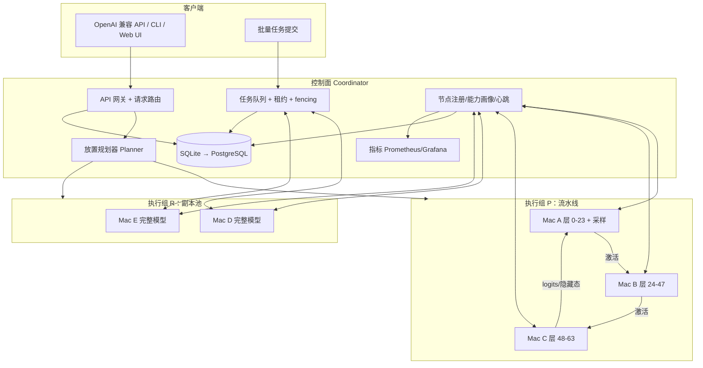

# Mac 分布式 GPU 与 LLM 运行系统：技术评估与开发方案

> 版本：v0.1（2026-10-14）
> 输入：Apple 论文《Minions》（arXiv:2610.12970）、`doc1.md` 初步分析、Strata v0.1.44、moe-on-a-desk、MLX 分布式官方文档、exo 公开资料
> 工作代号：**mlx-swarm**（暂定）

---

## 0. 结论摘要

1. **可以实现，但两个目标要用不同技术路线，不能靠一套机制同时达成。**
   - 目标 1「小内存跑大模型」：靠**模型切分（Pipeline 流水线并行为主）**+ **单机 MoE 专家分层存储（SSD 流式）**。
   - 目标 2「提升吞吐」：靠**副本并行（Minions 式任务池）**、**流水线多请求交错**、**单机投机解码**。单条对话的生成速度靠堆机器基本提不上去，除非有 Thunderbolt 5 RDMA。
2. **对 doc1.md 的修正**：doc1 建议"首版不用 `mx.distributed`"，这对目标 2 成立，但目标 1 是你的首要目标之一，必须做模型切分。关键判断是：
   - **流水线并行（PP）对网络要求很低**：每个 token 每跨一台机器只传一个隐藏向量（约 8–16 KB），普通 10GbE、Thunderbolt 4 网桥甚至有线千兆都能用。**这是本项目的主力路线。**
   - **张量并行（TP）对延迟极敏感**：每层需要 2 次 all-reduce，只有 TB5 + RDMA（JACCL，macOS 26.2+，M4 Pro/Max、M5 Pro/Max 等带 TB5 的机型）才划算。基础款 M4/M5 只有 TB4，**无法使用 RDMA**，所以 TP 只作为可选高端模式。
3. **论文本身不提供模型并行能力**：Minions 只是"空闲 Mac 领任务"的批处理资源池（Ollama 后端、PostgreSQL 抢占、5 分钟心跳、S3 存储），没有任何吞吐/加速基准。它的价值在调度和容错设计，可直接借鉴为本系统的"副本池"模式。
4. **市场上已有 exo（MLX 后端、支持 PP/TP/RDMA）**。本项目的差异化定位应是：
   **异构、可间歇在线的 Mac 资源池 + 普通网络下的流水线切分 + 单机加速（MTP 投机解码、MoE 专家流式加载）+ 批处理任务调度**。
   建议在 P0 阶段先实测 exo，再决定"自研"还是"基于 mlx-lm 自研并选择性复用 exo 思路"（见 §9 决策点）。
5. **对预期要诚实**：在基础款 M5（约 153 GB/s 内存带宽）上，dense 70B 4bit 模型即使能装下，单流解码也只有约 2–3 tok/s。**"分布式 + MoE 模型"才是小内存 Mac 的甜点组合**：总参数大（需要多机装下），激活参数小（解码快）。

---

## 1. 参考资料评估

### 1.1 Apple《Minions》论文（arXiv:2610.12970）

| 项目 | 内容 | 对本项目的价值 |
|---|---|---|
| 架构 | Server（拆任务/API/UI）+ PostgreSQL（7 张表）+ Executor（每台 Mac 拉取任务）+ Watchdog | 直接借鉴为「副本池模式」的控制面 |
| 调度 | 拉取式；`(team, project, task, subtask_id)` 唯一约束 + `ON CONFLICT DO NOTHING` 抢占；FIFO；Executor 可绑定偏好项目 | 借鉴，但需补 fencing token（doc1 已指出） |
| 容错 | 5 分钟心跳，Watchdog 回收失联任务 | 借鉴，但心跳要缩短到 5–15 秒级 |
| 推理后端 | LLM 用 Ollama，embedding 用 HF transformers | 改为 MLX（mlx-lm），性能和可控性更好 |
| 数据 | 输入输出走 S3，大数据不经过 Server | 本地化场景可换成 MinIO / 共享目录 / 节点直传 |
| 量化结果 | 无吞吐/延迟/能耗基准；只说排队时间从"小时级（可达 10h+）"降到"分钟级" | **不能**用来推断加速比 |
| 模型并行 | 无 | 目标 1 需要另起技术路线 |

### 1.2 Strata（v0.1.44 起支持 Mac）

- C/C++，基于 ggml（llama.cpp），MIT 协议。核心是**MoE 专家三级放置**：GPU 放热门专家 → 内存放全部专家 → SSD 兜底流式读取；外加 MTP 投机解码（1.6–1.9×）。
- Mac 实测（Release notes）：
  - M5 Max 128GB：IQ3_S 解码 95–103 tok/s，预填充 1,150–1,540 tok/s；UD-Q6_K_XL 从 SSD 流式约 50 tok/s（llama.cpp 跑不了）。
  - **M4 mini 32GB，专家从 SSD 流式：8–14 tok/s**（llama.cpp CPU 为 4–6）。
- 关键工程经验：64GB 以上 Mac 把总占用控制在内存 60% 以下并 **wire 专家内存区**，否则 macOS 内存压缩会触发 watchdog panic。
- 限制：单请求、单机、实验性（只在 2 台 Mac 测过）、上下文仅测到 32K。

**价值**：证明了「单机 + SSD 专家流式」可以让 32GB Mac 跑 125B MoE，这是目标 1 的**单机补充手段**，与多机切分可以叠加。

### 1.3 moe-on-a-desk

- llama.cpp Metal 分支，M4 Max 64GB 单机。纯工程优化：MTP 精确投机解码、1-bit 草稿输出头筛候选、按置信度停止草稿、GPU spin-wait、小批次图缓存、延迟释放、融合算子、mmap 大表 + 并行缺页。
- 收益：Qwen3.8 125B 解码 +46%~+63%（约 117–125 tok/s），Qwen3.6-35B-A3B +32%~+57%。
- 未做多机；作者把"两台机器跑 GLM-5.3-Flash"列为未来目标。

**价值**：给出了**单节点解码加速的清单**，每个分布式节点的单机效率决定集群上限，这些技巧应进入 P3。

### 1.4 MLX 分布式能力（官方文档）

| 后端 | 传输 | 约束 | 适用 |
|---|---|---|---|
| ring | TCP | 只能与环上邻居通信（不支持任意 send/recv） | **PP 天然契合**（链式/环式） |
| jaccl | RDMA over TB5 | macOS 26.2+；需在恢复模式执行 `rdma_ctl enable`；**全互联拓扑**（每两台都要直连线） | TP / 专家并行 |
| mpi | TCP | 需装 OpenMPI | 备选 |

- 已有张量并行层：`AllToShardedLinear`、`ShardedToAllLinear` 及量化版本、`shard_linear` 等。
- 启动：`mlx.launch --hosts ... --backend ring|jaccl`。
- 官方说 JACCL 延迟比 ring 低一个数量级；`MLX_METAL_FAST_SYNCH=1` 可降低 CPU-GPU 同步开销但可能死锁。
- mlx-lm 已有 `sharded_load(repo, pipeline_group, tensor_group)`，详见 §1.6 本地核查。

### 1.6 本地已有 MLX 环境核查（`finetuning_recipes/packllm`）

packllm（装柜宝微型 LLM，MLX 原生 LoRA/GRPO 训练）的 `.venv` 已安装 **mlx 0.32.1、mlx-lm 0.31.3、mlx-lm-lora**，用 uv + 清华镜像管理依赖。在这台 M5 32GB 机器上核查 mlx-lm 源码，得到以下结论：

| 能力 | 现状（mlx-lm 0.31.3） | 对本项目的含义 |
|---|---|---|
| 分布式后端 | `ring`、`jaccl` 均已编译可用（`is_available` 为 True；jaccl 能否真正用 RDMA 还取决于 TB5 硬件和 `rdma_ctl enable`） | 无需自编 MLX |
| 分片加载 | `utils.sharded_load()`：PP 模式下**每个节点只下载本阶段需要的 safetensors 文件** | 可直接复用，省去自写分片下载 |
| 流水线并行 | `models/pipeline.py` 中的 `PipelineMixin`，**只有 deepseek_v2/v3、glm4_moe、glm4_moe_lite、ministral3 接入** | Qwen3/Qwen3-MoE/Llama 需要自行接入（每个模型约几十行） |
| 切层策略 | **按层数平均切分**（rank0 拿最后几层），不考虑节点内存和带宽差异 | 异构切层 Planner（§4.1）是必须补的核心增量 |
| 张量并行 | 18 个模型实现了 `shard()`（llama、qwen2/3、qwen3_5、gpt_oss、deepseek、glm4_moe、minimax、kimi_k25 等） | Mode T 可直接用，前提是有 RDMA |
| PP 只支持 MLX 转换后的权重 | 需要 `model.safetensors.index.json` 的 weight_map | 模型仓库统一用 mlx-community 格式或自行 `mlx_lm.convert` |

**结论：** PP/TP 的底层原语已经存在，本项目不需要从零写分布式推理。真正要做的是 **异构切层、更多模型接入 PP、多请求交错调度、容错/重组、节点管理** 这些系统层工作，P2 的工作量因此可以下调约 30%。

**环境建议：** 新项目沿用 packllm 的 uv + 镜像配置，并锁定相同的 mlx/mlx-lm 版本。**P 组内所有节点的 mlx/mlx-lm 版本必须完全一致**，组建 P 组时强制校验。

### 1.5 exo（竞品/可复用对象）

- MLX 后端，自动发现，OpenAI/Claude/Ollama 兼容 API，支持 PP 与 TB5 RDMA 下的 TP。
- 官方宣称 2 台 1.8×、4 台 3.2×；第三方 4×M3 Ultra 测 DeepSeek V3.1 671B：单机 21.1 → 四机 32.5 tok/s。**结论：集群主要价值是"装得下"，速度提升有限。**
- 第三方报告提到 TP + RDMA 存在模型/后端相关的稳定性问题。

---

## 2. 技术可行性分析

### 2.1 Mac 推理的性能模型

**解码（逐 token 生成）是内存带宽受限的：**

$$
\text{tok/s}_{\text{单流}} \approx \frac{\eta \cdot BW_{\text{mem}}}{B_{\text{active}}}
$$

- $BW_{\text{mem}}$：内存带宽（M4 约 120 GB/s，M4 Pro 约 273，M4 Max 约 546，M5 约 153；M5 Pro/Max 以实测为准）
- $B_{\text{active}}$：每个 token 需读取的权重字节数（dense 模型 ≈ 全部权重；MoE ≈ 激活参数 × 量化位宽）
- $\eta$：实际效率，通常 0.6–0.8

**示例（基础款 M5，η=0.7）：**

| 模型 | 量化 | 权重 | 每 token 读取 | 理论单流解码 |
|---|---|---|---|---|
| Dense 8B | 4bit | ~4.5 GB | ~4.5 GB | ~24 tok/s |
| Dense 32B | 4bit | ~18 GB | ~18 GB | ~6 tok/s |
| Dense 70B | 4bit | ~40 GB | ~40 GB | ~2.7 tok/s |
| MoE 35B-A3B | 4bit | ~20 GB | ~2 GB | ~50 tok/s（受算子开销限制，实际更低） |
| MoE 120B-A6B | 3bit | ~48 GB | ~3 GB | ~35 tok/s 量级 |

> 推论：**dense 大模型切到多台小 Mac，"能跑"但很慢；MoE 大模型切到多台小 Mac，"能跑且可用"。** 本项目的模型支持优先级应是 MoE 优先。

**可用内存**：macOS 默认 GPU wired 上限约为物理内存的 65–75%，可通过 `sudo sysctl iogpu.wired_limit_mb=...` 调高，但要给系统和用户留余量（Strata 经验：≤60% 并 wire 关键区域更稳）。

$$
M_{\text{weights,shard}} + M_{\text{KV,shard}} + M_{\text{temp}} + M_{\text{reserve}} \le M_{\text{budget}}
$$

### 2.2 三种跨机切分方式的通信量对比

设隐藏维度 $d$（如 8192），bf16 激活，层数 $L$，节点数 $N$。

| 方式 | 每 token 通信 | 每 token 通信次数 | 对网络要求 | 单流解码加速 | 显存聚合 |
|---|---|---|---|---|---|
| **流水线并行 PP** | $d \times 2$ B ≈ 16 KB | $N$ 次（含回到采样节点） | 低：10GbE / TB4 网桥 / 千兆都可 | **无**（层串行执行，略有损耗） | ✅ |
| **张量并行 TP** | $d \times 2$ B × all-reduce | $2L$ 次（如 80 层 = 160 次） | 极高：需 RDMA 级延迟 | 有（带宽叠加） | ✅ |
| **专家并行 EP**（MoE） | 被路由 token 的激活 | 每 MoE 层 2 次 all-to-all | 高 | 有限 | ✅ |

**延迟预算估算（单流解码，70B 级 80 层）：**

| 网络 | 单次往返/跳延迟（量级） | PP（N=2，2 跳） | TP（160 次 all-reduce） |
|---|---|---|---|
| Wi-Fi 6 | 2–5 ms | 4–10 ms/token：可接受（模型本身 ~300ms/token） | 320–800 ms/token：不可用 |
| 千兆/2.5GbE | 0.2–0.5 ms | ~1 ms/token：可忽略 | 32–80 ms/token：不划算 |
| 10GbE / TB4 IP 网桥 | 0.1–0.3 ms | <1 ms/token：可忽略 | 16–48 ms/token：勉强 |
| TB5 + RDMA（JACCL） | ~3–9 µs（exo 宣称） | 可忽略 | ~1 ms/token：可用 |

**预填充（prompt 处理）**：PP 每跳传 $T \times d \times 2$ 字节，4K token × 8192 维 ≈ 64 MB，千兆约 0.5 秒、10GbE 约 50 ms、Wi-Fi 约 1 秒以上且有抖动。**结论：PP 节点之间推荐有线连接，但不是硬性要求，Wi-Fi 也能跑通。**

### 2.2.1 是否必须用专用线材直连？——不需要

**只有张量并行（Mode T）必须用 TB5 线直连加 RDMA**，其余模式用普通网络即可：

| 模式 | 目标 | 普通网络是否可行 | 推荐网络 |
|---|---|---|---|
| Mode R 副本池 | 吞吐 | ✅ 任意网络，包括 Wi-Fi，甚至跨公网 | 任意 |
| Mode P 流水线切分 | 装下大模型 + 并发吞吐 | ✅ 可行 | 千兆/2.5G 有线起步；10GbE 或 TB4 网桥更好；Wi-Fi 可用但长 prompt 慢 |
| Mode T 张量并行 | 单流加速 | ❌ 不可行 | TB5 全互联 + RDMA（macOS 26.2+） |

推荐的组网档位：

1. **入门**：千兆/2.5G 交换机 + 网线，所有 Mac 接入同一局域网。目标 1 和目标 2 都能达成。
2. **进阶**：两台 Mac 用一根 Thunderbolt 4 线直连。macOS 会自动创建 IP 网桥（`bridge0`），**本质仍是普通 TCP 网络**，实测约 10–20 Gbps，成本只是一根雷雳线。
3. **高端（可选）**：TB5 全互联 + RDMA，仅用于 Mode T。基础款 M4/M5 不支持。

**唯一需要专用线直连的需求是"多台机器协同把单个对话生成得更快"**，这本身就是本项目的可选高端模式。

### 2.3 两个目标的可行性结论

| 目标 | 手段 | 可行性 | 预期效果 |
|---|---|---|---|
| 1. 小内存跑大模型 | 多机 PP 切层 | ✅ 高（MLX ring 后端 + 自研分片） | 可用内存 ≈ 各节点预算之和 × 0.9 |
| | 单机 MoE 专家 SSD 流式 | ⚠️ 中（MLX 无现成实现，需自研或接入 Strata/llama.cpp） | 32GB 跑 120B 级 MoE，8–14 tok/s 量级 |
| | 两者叠加 | ⚠️ 研究性 | 进一步扩大模型上限 |
| 2. 提升吞吐 | 副本池（每机完整模型） | ✅ 高 | 批量任务近线性扩展（N 台 ≈ 0.85–0.95 N 倍） |
| | PP + 多请求交错 | ✅ 高 | 并发 ≥ N 时，各阶段同时忙碌，聚合吞吐接近单机的 N 倍 |
| | 单机投机解码（MTP/草稿模型） | ✅ 中高 | 单流 1.3–1.9×（参考 Strata、moe-on-a-desk） |
| | 单机连续批处理 | ✅ 高 | 并发场景吞吐数倍提升 |
| | TP（TB5 RDMA） | ⚠️ 依赖硬件 | 2 台约 1.5–1.8×，4 台 2–3×（以实测为准） |

---

## 3. 系统总体设计

### 3.1 四种运行模式

```text
Mode R  Replica    副本池       每台机器完整模型，独立处理请求/子任务        → 吞吐
Mode P  Pipeline   流水线切分   一组机器各持部分层，链式传递激活              → 装下大模型 + 并发吞吐
Mode T  Tensor     张量切分     TB5 RDMA 全互联组内，每层切分                 → 单流加速（可选）
Mode L  Local+     单机增强     MoE 专家 SSD 流式、投机解码、KV 量化          → 每个节点的效率
```

一个集群可以同时存在多个"执行组"：例如 2 台 M5 组成 P 组跑 120B MoE，另外 3 台 M4 作为 R 池跑 8B 批量摘要。

### 3.2 架构图



### 3.3 组件说明

| 组件 | 职责 | 技术选型 |
|---|---|---|
| **Node Agent**（每台 Mac） | 能力探测、基准测试、模型缓存、闲置检测、心跳、启动/停止推理 Worker 进程 | Python 3.12 + asyncio；后期 Swift 菜单栏 App 包装 |
| **Inference Worker** | 实际 MLX 推理进程；支持完整模型 / 分片 / TP 三种加载方式；连续批处理；KV 管理 | Python + mlx + mlx-lm；热点算子用 Metal 自定义 kernel |
| **Coordinator** | API 网关、路由、规划器、任务队列、节点注册 | Python FastAPI（或 Go，见 §9）；SQLite 起步，可切 PostgreSQL |
| **Data Plane** | PP 激活传输、TP 集合通信 | MLX `ring`（TCP）/ `jaccl`（RDMA）；必要时自研 TCP 流（支持非环拓扑） |
| **Discovery** | 局域网自动发现 | Bonjour/mDNS（`_mlxswarm._tcp`）+ 手动 hostfile |
| **Model Store** | 模型下载、分片预切、校验 | HF Hub + 本地 safetensors；节点间 P2P 拷贝（局域网比外网快） |
| **Observability** | tok/s、TTFT、内存压力、温度、网络 RTT | Prometheus exporter + Grafana；CLI `swarm top` |

### 3.4 节点能力画像（Planner 的输入）

Agent 启动时测量并上报：

```yaml
node_id: m5-macbook-01
chip: Apple M5            # sysctl machdep.cpu.brand_string
gpu_cores: 10
mem_total_gb: 32
mem_budget_gb: 20         # 用户可配置上限
mem_bw_measured_gbs: 118  # 实测 memcpy/读带宽
tflops_fp16_measured: ...
ssd_read_gbs: 6.5         # MoE 流式用
links:                    # 到其他节点的实测
  - peer: m4-mini-02; iface: bridge0 (TB4); rtt_us: 180; bw_gbps: 18
  - peer: m4-mini-03; iface: en0 (10GbE); rtt_us: 120; bw_gbps: 9.4
rdma: false               # ibv_devices 检测
os: "27.0"
mlx_version: ...
availability: dedicated | idle_only | scheduled
```

---

## 4. 核心算法设计

### 4.1 流水线切层规划（异构节点）

目标：给定模型每层的显存占用 $m_\ell$ 和计算成本 $c_\ell$（解码阶段 ≈ 该层权重字节数），节点集合按链路顺序 $1..N$，节点 $k$ 内存预算 $M_k$、有效带宽 $BW_k$，求连续切分点，使**最慢阶段时间最小**：

$$
\min_{\text{切分}} \max_k \left( \frac{\sum_{\ell \in S_k} c_\ell}{BW_k} + t_{\text{link},k} \right)
\quad \text{s.t.} \quad \sum_{\ell \in S_k} (m_\ell + kv_\ell) + M_{\text{embed/head},k} \le M_k
$$

- 层是连续区间，用动态规划 $O(N L^2)$ 或二分答案 + 贪心 $O(L \log C)$ 即可（L ≤ 200，毫秒级）。
- Embedding 和 LM head（大词表时可达数 GB）分配给首/尾节点，计入其内存。
- 节点顺序：按链路质量构建最短环（节点少时直接枚举排列）。
- **单流延迟模式**：每 token 时间 = Σ 阶段时间 + Σ 链路延迟（所以总时间 ≈ 单机若能装下的时间 + 网络开销）。
- **吞吐模式**：最小化最大阶段时间，让多请求交错时流水线不空转。

### 4.2 流水线执行与多请求交错

```text
时间 →      t1      t2      t3      t4
Mac A     R1-tok   R2-tok  R3-tok  R1-tok
Mac B              R1-tok  R2-tok  R3-tok
Mac C                      R1-tok  R2-tok
```

- 单请求时只有一台机器在忙（流水线气泡）——这就是 PP 不能加速单流的原因。
- 并发请求数 ≥ 阶段数时，所有阶段同时工作；每个阶段内部还可对多个请求做 batch（解码是带宽受限，batch 4–8 的边际成本很低）。
- 实现：每个阶段一个事件循环，`recv 激活 → forward(该阶段层, 各请求自己的 KV) → send`；采样在首节点进行（持有 LM head 时）或尾节点进行后把 token id（4 字节）发回首节点。
- KV cache 天然按层分布在各节点，**长上下文的 KV 内存也被分摊**，这也是目标 1 的重要收益。

### 4.3 副本池调度（继承 Minions + doc1 改进）

- 状态机：`queued → leased(attempt_id, fencing_token, lease_expiry) → succeeded | failed → queued`
- 领取：`UPDATE ... SET owner, token=token+1, lease_expiry=now()+30s WHERE id=(SELECT ... FOR UPDATE SKIP LOCKED LIMIT k)`（PostgreSQL）；SQLite 版用单写者事务。
- 提交：`WHERE id=? AND fencing_token=?`，不匹配直接丢弃；每次尝试写独立结果路径。
- 心跳：5–10 秒续约（论文 5 分钟太慢）；心跳线程与推理进程分离。
- 任务切分：按 $\hat T = N_{in}/r_{prefill} + \hat N_{out}/r_{decode}$ 估算并切成目标 30–120 秒的小批（doc1 §1）。
- 选择排序：权限 → 模型/版本兼容 → 内存预算 → 项目偏好 → 模型已加载 > 已缓存 > 需下载 → 等待时间老化加分。

### 4.4 交互式请求路由

- 每个模型可有多个后端（若干 R 副本 + 若干 P 组）。路由按"预计完成时间"最小：队列长度 × 平均服务时间 + 预填充估计 + 前缀缓存命中折扣。
- **前缀亲和**：同一会话尽量路由到上次的副本，复用 prompt cache（mlx-lm 支持 prompt cache 持久化）。

### 4.5 闲置检测与让出（idle_only 节点）

| 信号 | 获取方式 |
|---|---|
| 用户输入空闲时长 | IOKit `HIDIdleTime` |
| 供电/电池 | `pmset -g batt`、IOPowerSources |
| 热状态 | `ProcessInfo.thermalState`（Swift 辅助进程）/ `powermetrics` |
| 内存压力 | `DispatchSource.makeMemoryPressureSource` / `memory_pressure` / `vm_stat` |
| 前台 GPU 占用 | `ioreg` IOAccelerator 统计 |
| 合盖/睡眠 | IOKit 电源通知；工作时 `caffeinate -i` 防止空闲睡眠（需用户授权） |

规则：**idle_only 节点只进 R 池，不进 P/T 组**（P 组任一节点退出会中断整组请求）。

### 4.6 P 组容错

- 组内任一节点心跳丢失 → 组标记 degraded → 进行中请求失败并返回可重试错误（或由网关透明重试）。
- 透明重试：网关保存 `prompt + 已生成 token`，在新组/重组后重新 prefill 再继续生成（用户感知为一次停顿）。
- 重新规划：剩余节点能装下则重切层（需重新加载权重，分钟级）；不能则降级到更小模型或排队。
- 预切分片缓存在各节点 SSD 上，换层范围时只加载缺的层，缩短恢复时间。

### 4.7 单机加速（Mode L）

按收益/难度排序：

1. **连续批处理**（mlx-lm 已有 batch generate 能力，补齐服务端调度）——并发吞吐收益最大。
2. **Prompt/前缀缓存**——多轮对话 TTFT 大幅下降。
3. **投机解码**：优先使用模型自带 MTP 头（精确验证，输出不变）；无 MTP 时用小草稿模型。参考 moe-on-a-desk 的"置信度停止"和"草稿输出头候选裁剪"。
4. **KV cache 量化**（4/8bit）——长上下文省内存。
5. **MoE 专家分层存储**：热门专家常驻 GPU wired 内存，冷专家 mmap + 预取，按路由统计动态调整。MLX 无现成实现，属于研究型工作（可参考 Strata 思路；注意 macOS 内存压缩/wired 限制）。
6. **Metal 内核微优化**（GPU spin-wait、图缓存、融合算子）——放到最后，按 profiling 结果做。

---

## 5. 关键技术风险

| 风险 | 影响 | 概率 | 缓解 |
|---|---|---|---|
| 基础款 M4/M5 只有 TB4，无 RDMA | TP 不可用，单流不能靠多机加速 | 确定 | 定位清晰：PP 负责装下，加速靠单机优化 + 并发 |
| Dense 大模型分布式后仍很慢 | 用户体验差 | 高 | 文档明确推荐 MoE；Planner 给出预计 tok/s，提前告知 |
| MLX ring 后端只支持邻居通信 | 非链式拓扑受限 | 中 | PP 本就是链/环；必要时自研 TCP data plane |
| macOS 内存压缩/wired 限制导致卡死或 panic | 节点崩溃 | 中 | 预算 ≤ 60–70%；wire 关键区；内存压力监听主动降级 |
| 跨节点 MLX/mlx-lm/模型版本不一致 | 结果错误或崩溃 | 中 | 组建 P/T 组时强制校验版本 + 权重 hash |
| P 组节点中途退出 | 请求中断 | 中 | 只用 dedicated 节点；透明重试；快速重切 |
| RDMA/TP 稳定性问题（第三方已报告） | 高端模式不可用 | 中 | TP 标记实验性，默认关闭 |
| 与 exo 功能重叠 | 社区价值降低 | 中 | 差异化定位（§0.4）；P0 后评估是否向上游贡献 |
| 局域网内数据安全 | 提示词/结果泄露 | 中 | mTLS + 节点准入令牌；团队/组织级隔离（论文同样建议） |

---

## 6. 开发路线图

假设 2–3 名工程师（1 名熟悉 MLX/Metal，1 名后端/分布式，0.5–1 名 macOS 客户端）。

### P0 · 基线与可行性验证（2 周）

**目的：用数据确认路线，避免拍脑袋。**

- [ ] 准备至少 2–3 台 Mac（含你的 M5 32GB），统一 macOS 与 Python 环境；沿用 packllm 的 uv 配置，锁定 mlx 0.32.1 / mlx-lm 0.31.3
- [ ] 用 `mlx.launch --backend ring` + `sharded_load` 在 2 台机器上跑通 GLM-4.x MoE 的流水线推理（现成支持 PP 的模型）
- [ ] 单机基线：8B/32B dense、35B-A3B MoE 在各机型的预填充 tok/s、解码 tok/s、峰值内存
- [ ] 网络微基准：TB4 网桥、10GbE、千兆、Wi-Fi 的 RTT 与吞吐（iperf3 + 自写 16KB ping-pong）
- [ ] 跑通 mlx-lm 的分片/流水线示例（2 台），记录单流 tok/s 与"单机若能装下"的对比
- [ ] 实测 exo 同场景表现，作为对照基线
- [ ] （若有 TB5 机器）验证 JACCL 与 TP

**Go/No-Go 指标：**
- 2 台 PP 跑单机装不下的模型，单流解码 ≥ 理论值的 70%
- PP 网络开销占每 token 时间 < 10%（有线）
- 产出《基准报告 v1》

### P1 · MVP：副本池 + 统一 API（4–6 周）

- [ ] Node Agent：能力探测、注册、心跳、模型缓存、Worker 进程管理
- [ ] Coordinator：OpenAI 兼容 `/v1/chat/completions`（流式）、`/v1/embeddings`、批量任务 API
- [ ] 任务队列：租约 + fencing + 重试 + 去重（SQLite 实现，PostgreSQL 可选）
- [ ] 路由：最短预计完成时间 + 会话亲和
- [ ] mDNS 自动发现、`swarm` CLI（`swarm up / nodes / run / bench / top`）
- [ ] 故障注入测试：杀进程、断网、睡眠后恢复，验证"有效结果只提交一次"

**交付**：v0.1，N 台 Mac 组成 OpenAI 兼容推理池，批量任务吞吐近线性。

### P2 · 流水线切分：跑单机装不下的模型（6–8 周）★ 目标 1 核心

- [ ] 复用 `mlx_lm.utils.sharded_load`；改造 `PipelineMixin.pipeline()`，从"平均切"改为接受 Planner 给出的任意层区间
- [ ] 为 Qwen3 / Qwen3-MoE / Llama 等接入 PipelineMixin（DeepSeek/GLM 已有，可先用 GLM-4.x MoE 跑通）；改动尽量提 PR 回上游 mlx-lm
- [ ] 支持模型族：GLM/DeepSeek MoE（现成）→ Qwen 系 MoE/dense → Llama
- [ ] 异构切层 Planner（§4.1）+ 预计 tok/s 与内存报告（dry-run 模式）
- [ ] PP 执行引擎：MLX ring 后端 → 视需要自研 TCP data plane（零拷贝、预填充分块流水）
- [ ] 多请求交错 + 阶段内 batch（§4.2）
- [ ] P 组生命周期：组建、版本/hash 校验、预热、降级、透明重试（§4.6）
- [ ] 分布式 KV 管理与长上下文测试

**交付**：v0.2，例如 2×32GB M5 跑 ~100B 级 MoE 量化模型；3 台跑 70B dense 4bit。

### P3 · 单机加速（4–6 周，可与 P2 并行）★ 目标 2

- [ ] 连续批处理调度器（服务端）
- [ ] Prompt/前缀缓存、KV 量化
- [ ] 投机解码：MTP 头优先，草稿模型备选；PP 模式下草稿在首节点运行，验证走流水线（一次验证多 token，摊薄网络与气泡开销——这对 PP 单流提速很有价值）
- [ ] Profiling 驱动的 Metal 内核优化

**交付**：v0.3，单流 1.3–1.8×，并发吞吐数倍。

### P4 · 高级模式（6–10 周，按硬件与需求择项）

- [ ] Mode T：TB5 RDMA 组内 TP（JACCL），可与 PP 组合（组内 TP、组间 PP）
- [ ] MoE 专家分层存储（GPU wired 热专家 + SSD 冷专家流式 + 预取）
- [ ] MoE 专家并行（EP，需 RDMA）
- [ ] 混合组：PP 组中某阶段用"单机 + SSD 流式"扩容

### P5 · 产品化与开源发布（4 周，持续）

- [ ] SwiftUI 菜单栏 App：一键加入集群、闲置策略、资源上限、实时状态
- [ ] 安全：mTLS、节点准入令牌、模型 hash 校验、团队隔离
- [ ] 打包：Homebrew formula / `uv tool install`、签名公证的 .app
- [ ] 文档：部署指南、组网指南（TB4 网桥/10GbE/TB5 RDMA）、模型兼容矩阵、基准报告
- [ ] CI：Apple Silicon runner 跑单元测试 + 单机集成测试；多机测试走自托管 runner 夜间任务

**总周期**：MVP（P0+P1）约 2 个月；能跑大模型（+P2）约 4 个月；完整 v1.0 约 6–8 个月。

---

## 7. 代码仓库结构（建议）

```text
mlx-swarm/
├── swarm/
│   ├── agent/            # Node Agent：探测、心跳、闲置检测、进程管理
│   ├── worker/           # MLX 推理进程
│   │   ├── loader.py     # 完整/分片/TP 加载
│   │   ├── engine.py     # 连续批处理、KV 管理
│   │   ├── pipeline.py   # PP 阶段执行循环
│   │   ├── speculative.py
│   │   └── moe_offload/  # 专家分层存储（P4）
│   ├── coordinator/      # API 网关、路由、Planner、任务队列
│   ├── planner/          # 切层 DP、能力模型、tok/s 预估
│   ├── transport/        # ring/jaccl 封装、自研 TCP data plane
│   ├── discovery/        # mDNS
│   └── cli/              # swarm 命令
├── macos-app/            # SwiftUI 菜单栏客户端
├── bench/                # 基准脚本与结果格式
├── tests/                # 单测 + 故障注入 + 多机集成
└── docs/
```

**许可证建议**：Apache-2.0（与 MLX 的 MIT、mlx-lm 的 MIT 兼容，含专利授权，对企业友好）。若复用 exo 代码，需先核实其许可证兼容性。

---

## 8. 测试与基准方案

| 维度 | 指标 | 方法 |
|---|---|---|
| 正确性 | 分布式 vs 单机 greedy 输出逐 token 一致；困惑度一致 | 小模型在单机与 2/3 机 PP 下对比 |
| 单流性能 | TTFT、解码 tok/s、vs 理论值比例 | 固定 prompt 集（短/4K/32K） |
| 吞吐 | 并发 1/4/16/64 下总 tok/s、P50/P99 延迟 | 负载生成器 |
| 扩展效率 | N 台吞吐 / (N × 单机吞吐) | R 池与 P 组分别测 |
| 容错 | 恢复时间、重算量、有效结果唯一 | 故障注入（kill -9、拔线、睡眠） |
| 用户影响 | 内存压力等级、前台响应、让出耗时 | 闲置节点模拟用户回归 |
| 能耗 | tok/J | `powermetrics` |

**硬件矩阵（最小）**：M4 16/24GB、M4 Pro（TB5）、M5 32GB（你当前机器）、M5 Pro/Max（如有）；网络：Wi-Fi、千兆、10GbE、TB4 网桥、TB5 RDMA。

---

## 9. 需要你决定的事项

1. **自研 vs 基于 exo**：建议 P0 实测后决定。我的倾向是**基于 mlx-lm 自研**，因为本项目的重点（批处理任务池、间歇在线节点、异构规划、MoE 流式）与 exo 的"固定集群跑大模型"定位不同；但 PP/TP 的执行细节可参考 exo。
2. **Coordinator 语言**：Python（与 Worker 统一，迭代快，推荐首版）vs Go（部署单二进制、并发好）。
3. **首批目标模型**：建议 Qwen 系 MoE（社区量化版本多、MLX 支持好）+ 一个 dense 70B 作为对照。
4. **硬件**：请提供可用 Mac 的数量、型号/内存、连接方式（是否有 TB5 机型、是否有 10GbE），这决定 P0 的测试矩阵和是否启用 P4 的 TP。

---

## 10. 参考

- Minions 论文：https://arxiv.org/html/2610.12970v1
- Strata：https://github.com/Niko1221/Strata ，Mac 支持：https://github.com/Niko1221/Strata/releases/tag/v0.1.44
- moe-on-a-desk：https://github.com/hokar3361/moe-on-a-desk
- MLX 分布式文档：https://ml-explore.github.io/mlx/build/html/usage/distributed.html
- MLX LM：https://github.com/ml-explore/mlx-lm
- exo：https://github.com/exo-explore/exo
- exo/RDMA 第三方评测汇总：https://noqta.tn/en/blog/exo-distributed-ai-cluster-apple-silicon-local-llm-2026

> 说明：本文中的带宽、延迟、tok/s 估算基于公开资料与带宽模型推算，尚未在你的设备上实测；所有性能目标以 P0 基准报告为准。
